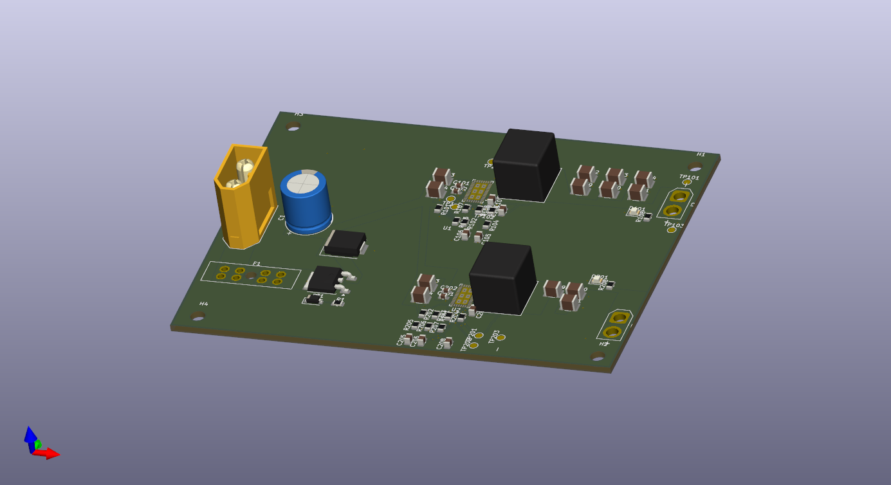
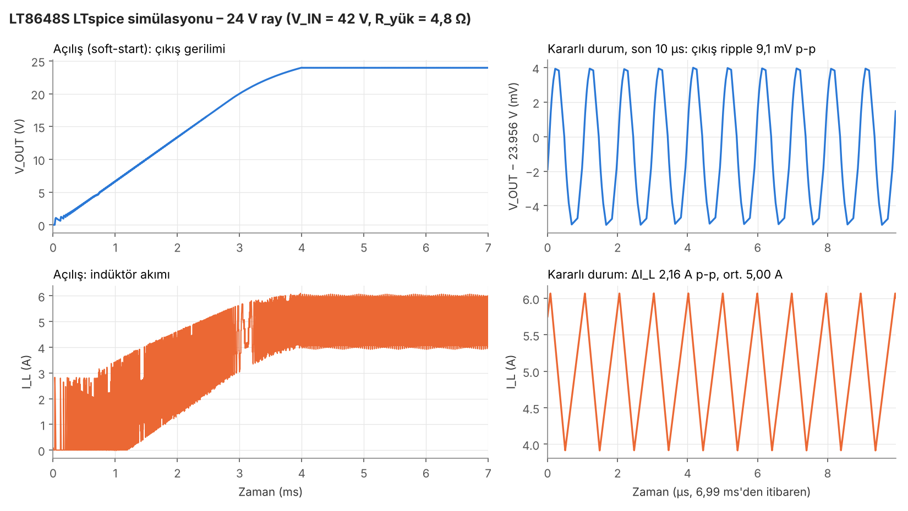

# 42 V → 24 V / 12 V Buck Dönüştürücü Kartı

İTÜ Rover Elektronik Ekibi '25 dönemi devre tasarımı ödevi (Devre Örneği 1). 10S Li-ion bataryadan (30–42 V) gelen gerilimi iki ayrı LT8648S ile 24 V ve 12 V'a düşüren, her çıkıştan 5 A verebilen dört katmanlı güç kartı. KiCad 9 ile tasarlandı, LTspice ile simüle edildi.

## Özellikler

| | |
|---|---|
| Giriş | 30–42 V (10S Li-ion), XT60 |
| Çıkışlar | 24 V / 5 A ve 12 V / 5 A, XT30 |
| Regülatör | 2 × Analog Devices LT8648S (Silent Switcher 2), 1 MHz |
| İndüktör | 4,7 µH Coilcraft XAL1010-472ME (iki çıkışta aynı) |
| Korumalar | 10 A ATO sigorta, P-MOSFET ile ters polarite koruması, SMCJ43A TVS, 100 µF bulk kondansatör, 27,8 V'ta açılıp 26,7 V'ta kapanan düşük gerilim kilidi |
| Kart | 100 × 75 mm, 4 katman (iç katmanlar kesintisiz GND) |
| Diğer | Her çıkışta durum LED'i, PG sinyali ve test noktaları |

## Simülasyon sonuçları (V_IN = 42 V, tam yük)

| | 24 V ray | 12 V ray |
|---|---|---|
| Ortalama çıkış | 23,96 V | 12,04 V |
| Çıkış dalgalanması (tepe-tepe) | 9,1 mV | 4,5 mV |
| İndüktör dalgalanma akımı (hesap / simülasyon) | 2,19 A / 2,16 A | 1,82 A / 1,80 A |
| Açılış süresi | ≈ 4 ms, aşırı yükselme yok | ≈ 4 ms, aşırı yükselme yok |

## Klasörler

| Klasör | İçerik |
|---|---|
| `KiCad_Proje/` | KiCad 9 projesi: hiyerarşik şematik (giriş koruması, 24 V, 12 V), kart dosyası, proje kütüphaneleri (`Lib/`) ve DRC raporu |
| `Uretim_Dosyalari/` | Gerber, drill, job dosyası ve BOM |
| `Simulasyon/` | LTspice devreleri (`.asc`) ve sonuç grafikleri |
| `Gorseller/` | Şematik PDF ve kart görselleri |
| `Rapor_AhmetFurkanBilgin.pdf` | Açık uçlu sorular, bileşen seçimi, hesaplamalar, simülasyon, riskler ve alternatifler |

## Projeyi açmak

`KiCad_Proje/BuckConvertor.kicad_pro` dosyasını KiCad 9 ile aç. Sembol ve footprint kütüphaneleri proje klasöründeki `Lib/` içinde, `${KIPRJMOD}` üzerinden bağlı; ek kurulum gerekmez.

Simülasyon için `Simulasyon/` içindeki `.asc` dosyalarını LTspice ile aç ve çalıştır (`.tran 7m startup`).

## Bilinen sınırlar

- LT8648S'nin maksimum giriş gerilimi 42 V, tam dolu 10S paket de 42 V veriyor; giriş payı yok. Ayrıntı ve alternatifler raporun 2.7 ve 2.8 bölümlerinde.
- 24 V entegresi tam yükte belirgin şekilde ısınır (tahmini 6–9 W kayıp).
- Yük basamağı ve düşük gerilim kilidi henüz simüle edilmedi.

Hazırlayan: Ahmet Furkan Bilgin
